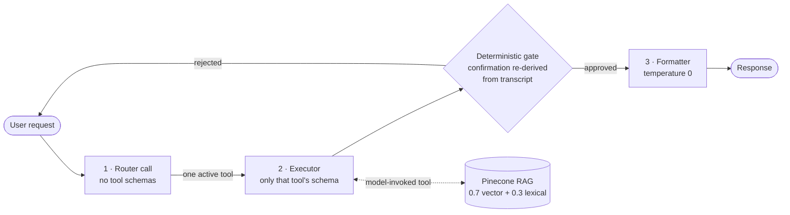

<!-- ═════════════════════════  HEADER  ═════════════════════════ -->
<p align="center">
  
</p>

<p align="center">
  
</p>

<p align="center">
  <a href="https://github.com/DevRohan33">
    
  </a>
</p>

<p align="center">
  
  
  
</p>

<p align="center">
  <a href="https://rohanparveag.online"></a>
  <a href="mailto:skrohanparveag@gmail.com"></a>
  
  
</p>

---

## 👨‍💻 About me

<table>
<tr>
<td width="58%" valign="top">

I'm a **Software Developer at Design Intelligence LLP**, where I build backend systems and **production AI**: tool-calling agents, RAG pipelines and the data infrastructure under them.

I take work from the **requirement to a deployed LLM system**, and I design for the ways those systems fail. Correctness is enforced with **rules in the backend**, not prompt instructions.

- 🔭 Building an **agentic engineering assistant** used in production
- 🧠 Working with **RAG, LangGraph multi-agent flows and MCP**
- 🏗️ Own backend architecture and **Docker / VPS** deployments
- ⚡ Electronics by training, software by choice, AI by intent

</td>
<td width="42%" valign="top">

```yaml
name:      SK Rohan Parveag
role:      Software Developer
company:   Design Intelligence LLP
domain:    Backend + Applied AI
stack:     [Python, FastAPI, OpenAI,
            LangChain, PostgreSQL, Docker]
shipping:  LLM agents, RAG, data pipelines
principle: "Correctness in code,
            not in the prompt"
location:  Kolkata, India
```

</td>
</tr>
</table>

---

## 💼 Experience

<table>
<tr>
<td align="center" width="22%">
  <br/>
  <sub><b>Feb 2025 – Jun 2025</b></sub>
</td>
<td>

### 🌱 Software Developer Intern
**Design Intelligence LLP** · Kolkata

- Built full-stack features across **React.js** and **Python REST APIs**
- Integrated **Flask** services for backend automation and workflow optimisation
- Implemented data processing pipelines with **Pandas** and interactive 3D components in **Three.js**

   

</td>
</tr>
<tr>
<td align="center" colspan="2">

⬇️ &nbsp; <b>Promoted after 4 months</b> &nbsp; ⬇️

</td>
</tr>
<tr>
<td align="center" width="22%">
  <br/>
  <sub><b>Jun 2025 – Present</b></sub><br/>
  
</td>
<td>

### 🚀 Software Engineer (Backend & AI)
**Design Intelligence LLP** · Kolkata

- 🤖 Design and ship **production LLM systems**: an agentic engineering assistant on OpenAI function calling, RAG retrieval and multi-agent automation
- 🔐 Built a **FastAPI integration layer** reconciling **QuickBase ↔ SAP**, with a credential-isolating proxy so no third-party keys reach the browser
- 🛰️ Built an **S3 / Wasabi asset pipeline** extracting EXIF geolocation from field media, validated against plausible bounds; automated bulk ops that were manual
- 🏗️ Own **backend architecture** across FastAPI services and **deployment** on Docker and self-managed VPS

    

</td>
</tr>
</table>

<details>
<summary><b>📜 Earlier experience</b></summary>
<br/>

| Period | Role | Company |
|---|---|---|
| 2024 | Python Programming Intern | CodSoft & Oasis Infobyte |
| Oct 2023 – Jun 2024 | Maintenance Engineer (solar plant systems) | Adani Solar |

</details>

---

## 🛠️ Tech stack

<table>
<tr>
<td width="150"><b>🤖 AI &amp; LLM</b></td>
<td>


</td>
</tr>
<tr>
<td><b>⚙️ Backend</b></td>
<td><br/>


</td>
</tr>
<tr>
<td><b>📊 Data</b></td>
<td>


</td>
</tr>
<tr>
<td><b>☁️ Infra &amp; DevOps</b></td>
<td><br/>


</td>
</tr>
<tr>
<td><b>🎨 Frontend</b></td>
<td></td>
</tr>
</table>

---

## 🚀 Featured work

### 🧩 Agentic Engineering Assistant &nbsp; 

   



<table>
<tr>
<td align="center" width="25%">📏<br/><b>Constant prompt size</b><br/><sub>independent of how many tools are registered</sub></td>
<td align="center" width="25%">🛡️<br/><b>Safety in code</b><br/><sub>skipped confirmations are rejected, not trusted</sub></td>
<td align="center" width="25%">♻️<br/><b>Fully stateless</b><br/><sub>multi-turn state recovered from the transcript</sub></td>
<td align="center" width="25%">🔎<br/><b>Hybrid RAG</b><br/><sub>1536-d embeddings, 700/120 chunks, idempotent ingest</sub></td>
</tr>
</table>

<table>
<tr>
<td width="50%" valign="top">

### 📰 [TechPluse](https://www.techpluse.in)
**Autonomous AI news pipeline**

   

```
discover → filter → dedupe → summarize → publish
          (zero humans in the loop)
```
- **Semantic dedup** catches the same story across outlets
- Low-signal items are dropped *before* the LLM call, so cost tracks signal, not volume

</td>
<td width="50%" valign="top">

### 📒 [RYBO](https://www.rybo.rohanparveag.in)
**Wholesale ledger product**

  

 

- Replaced a distributor's paper notebook: stock at running average cost, per-buyer rates, dues, PDF invoices
- Per-staff data isolation enforced in **Firestore security rules**, so no custom backend is needed

</td>
</tr>
</table>

### 🔧 Open source

<p align="center">
  <a href="https://github.com/DevRohan33/Abhyas-Voice-Coach"></a>
  <a href="https://github.com/DevRohan33/job-radar"></a>
  <br/>
  <a href="https://github.com/DevRohan33/wasabi-image-optimizer"></a>
  <a href="https://github.com/DevRohan33/my-leetcode-solutions"></a>
</p>

| | Project | What it does |
|:-:|---|---|
| 🎙️ | **Abhyas-Voice-Coach** | Real-time voice agent that interviews you, coaches your English and improves every session |
| 📡 | **job-radar** | Reads LinkedIn alert emails daily, scores each opening against your CV, ranks results into a Google Sheet |
| 🖼️ | **wasabi-image-optimizer** | GUI that bulk-converts Wasabi S3 images to WebP in parallel, with stop and resume |
| 🧮 | **my-leetcode-solutions** | DSA practice in Python |

---

## 🎓 Education

<table>
<tr>
<td align="center" width="50%">🎓 <b>B.Tech, Computer Science &amp; Engineering</b><br/><sub>Elitte College of Engineering (MAKAUT) · 2023 – 2026</sub></td>
<td align="center" width="50%">⚡ <b>Diploma, Electronics &amp; Telecommunication</b><br/><sub>Engineering Institute for Junior Executive, Howrah · 2020 – 2023</sub></td>
</tr>
</table>

---

## 📈 GitHub analytics

<p align="center">
  
  
</p>

<p align="center">
  
</p>

<p align="center">
  
</p>

---

## 🤝 Let's connect

<p align="center">
  <a href="https://github.com/DevRohan33"></a>
  <a href="https://rohanparveag.online"></a>
  <a href="mailto:skrohanparveag@gmail.com"></a>
</p>

<p align="center"><i>Always up for a conversation about backend architecture, RAG, agents and MCP.</i></p>

<p align="center">
  
</p>
